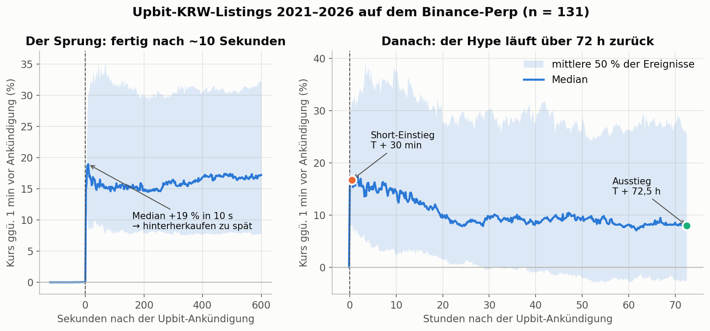
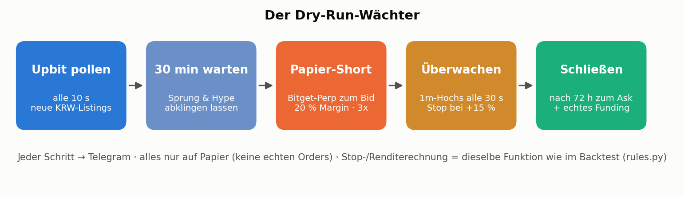
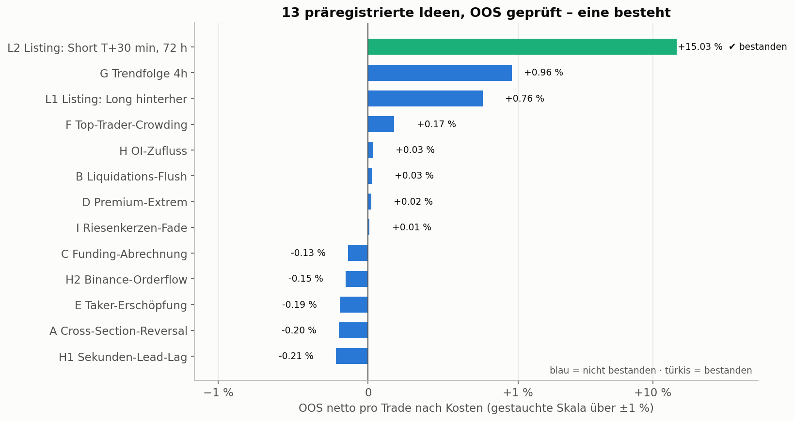
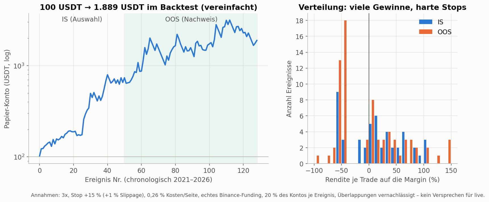

# 1mbot — Forschung mit nachweisbarem Edge, aktuell: Upbit-Listing-Short (Dry-Run)

Neustart Oktober 2026. Der alte Grid/Market-Making-Bot ist archiviert
(`botprojekte/_archiv/1mbot_grid_2026-08/`). Testkapital später 100 USDT. **Derzeit gehen keine echten Orders raus.**

## Die Idee in einem Bild

Wenn Upbit, die größte Börse Koreas, einen Coin für den Won-Markt (KRW) ankündigt, springt der
Kurs weltweit innerhalb von Sekunden, im Median um etwa +19 %. Hinterherkaufen ist zu spät.
In den folgenden Tagen läuft ein großer Teil des Hypes aber wieder zurück. Genau diese
Rückbewegung handelt der Bot als Short.



## Was läuft (`settings.json → "mode": "listing"`)

**Dry-Run-Wächter Upbit-KRW-Listing → Papier-Short auf Bitget**



1. Der Wächter fragt alle 10 s die Upbit-Ankündigungen ab (Kategorie Handel). Er erkennt neue
   KRW-Listings und liest den Ticker aus.
2. 30 Minuten nach der Ankündigung eröffnet er einen Papier-Short auf den Bitget-USDT-Perp zum
   echten Bid: 20 % des Papier-Kontos als Margin, 3x Hebel, Stop +15 %.
3. Die Position wird alle 30 s geprüft. Grundlage sind Bitget-1m-Hochs inklusive der laufenden
   Minute, damit der Stop sofort greift. Die Rechnung macht dieselbe Funktion wie im Backtest
   (`src/onembot/listing/rules.py`).
4. Nach 72 h schließt er zum echten Ask. Das echte Bitget-Funding wird verrechnet.
5. Telegram meldet jeden Schritt, morgens um 07 UTC kommt ein Tagesbericht.
   `./show_results.sh` zeigt Konto, Positionen und alle Trades.

Jeder Trade wird zweimal berechnet:
- mit den Backtest-Kosten (0,26 % pro Seite inkl. Slippage-Annahme), um direkt mit dem Backtest zu vergleichen,
- „roh“ mit echtem Bid/Ask und 0,06 % Gebühr, um zu sehen, wie realistisch die Kostenannahme war.

**Ziel des Dry-Runs:** 20–30 Ereignisse. Bei etwa 5 pro Monat dauert das rund 4–6 Monate.
Danach wird entschieden, ob live gehandelt wird.

## Forschungsstand (alles präregistriert, IS/OOS getrennt)

Jede Idee wurde vorher schriftlich festgelegt und versiegelt (SHA-256). Danach wurde sie auf
älteren Daten ausgewählt (IS) und auf neueren, unberührten Daten geprüft (OOS), mit Korrektur
für Mehrfachtests. Von 13 Ideen hat eine bestanden:



| Test | Ergebnis | Ordner |
|---|---|---|
| Sekunden-Lead-Lag Binance → Bitget (H1), Binance-Orderflow (H2) | nicht bestanden. Bitget holt Binance in ≤ 500 ms ein, das ist ein HFT-Feld | `research/` |
| 9 Ideen von 5m bis 4h (Reversal, Flush, Funding, Premium, Taker, Crowding, Donchian, OI, Kerzen-Fade) | 0/9 bestanden | `research/long/` |
| **Upbit-KRW-Listing: Short ab T+30 min, 72 h** | **bestanden** (OOS +15 %/Ereignis, t 4,45). Nach Funding und Squeeze-Risiko (3x, Stop 15 %) noch OOS +11,8 % auf Margin, aber t 1,4 | `research/listing/` |

### Backtest der bestandenen Idee (L2)



**Ehrlich gelesen:**
- Das Rohsignal ist sehr stark (OOS t = 4,45).
- Der Effekt hat einen nachvollziehbaren Grund: Wer frisch gepumpte Coins shortet, trägt
  Squeeze- und Funding-Risiko und wird dafür im Schnitt bezahlt.
- Etwa ein Drittel aller Trades endet am Stop mit ca. −50 % auf die Margin.
- Nach Funding und Squeeze-Risiko ist der Vorteil nicht mehr statistisch gesichert (t ≈ 1,4).
- Die Kontokurve ist vereinfacht: Überlappungen sind vernachlässigt, deshalb ist sie kein Versprechen.
- Darum läuft zuerst der Dry-Run.

Jedes Verzeichnis enthält `PRAEREGISTRIERUNG.md` (mit SHA-256) und `ERGEBNIS.md`. Die Backtests
sperren OOS, solange keine IS-Auswahl gespeichert ist.

## Bedienung (VPS)

```bash
./update.sh                       # bzw. ./install.sh bei Erstinstallation
sudo systemctl start 1mbot.service
./show_results.sh
tail -f logs/listing.log
```

`secret.json` braucht nur den Block `telegram`. Es werden keine API-Keys benötigt, alles läuft
über öffentliche Endpunkte. Ist `live_trading` auf true gesetzt, bricht der Start ab.

## Weitere Werkzeuge

- `"mode": "recorder"`: Sekunden-Recorder Binance + Bitget (Top-of-Book, Trades, Liquidationen), siehe `src/onembot/recorder/`, Anzeige mit `show_recorder.py`.
- `research/hist_fetch.py`: Tardis-Tick-Daten (Monatserste) im Recorder-Format.
- `research/long/fetch_binance.py`: Binance-Langzeitdaten (5m, Premium, Funding, OI-Metrics).
- `research/listing/`: Upbit-Ankündigungen und Ereignis-Daten, Backtest, Funding/MAE-Diagnose und Sizing.
- `research/make_figures.py`: erzeugt alle Grafiken in `docs/` aus den echten Forschungsdaten.
